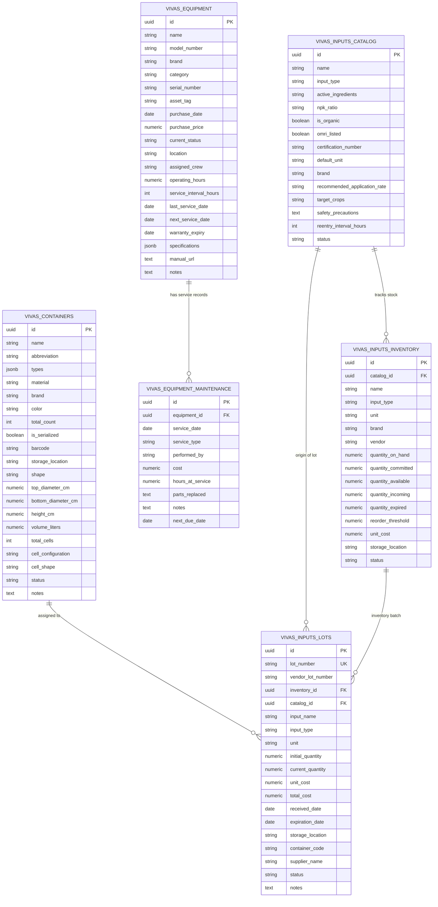

# Implementation Plan - Tend.com Assets Module Integration for Vivas AI

Build the complete **Assets Module** in Vivas AI with full parity to Tend.com's asset management workflow, tailored to Vivas AI's rich design aesthetics, database relationships, and CRUD APIs.

---

## 1. Overview & Architecture

The **Assets Module** consists of three core functional areas:
1. **Containers (`/assets/containers`)**: Comprehensive tracking of seedling flats, plug trays, harvest crates, bins, pots, and packaging boxes with serialization, barcodes, cell dimensions, and volume tracking.
2. **Equipment & Tools (`/assets/equipment-tools`)**: Tractors, seeding machines, harvesters, irrigation injectors, sprayers, cold storage units, and hand tools with maintenance intervals, runtime hours/mileage logs, scheduled service alerts, and operator assignments.
3. **Materials & Inputs (`/assets/materials-inputs`)**:
   - **Inputs Catalog**: Master registry of seeds, bio-fertilizers, organic amendments, compost, inoculants, and OMRI-listed pest control products with application rates and safety standards.
   - **Inventory On-Hand**: Real-time warehouse & storage quantities, available vs committed allocations, reorder thresholds, unit costs, and total valuation.
   - **Lot Management & Traceability**: Lot/batch numbers, vendor traceability, received dates, expiration alerts, and linked container storage codes.

---

## 2. Proposed Database Schema (`database/assets_migration.sql`)

### Tables & Relationships:

---

## 3. Backend RESTful API Endpoints (`backend/server.js`)

### A. Containers API:
- `GET /api/containers` (filter by type, material, brand, storage_location, serialized, search)
- `GET /api/containers/stats` (total containers, active types, total volume capacity)
- `GET /api/containers/:id` (single container detail)
- `POST /api/containers` (create new container with dimensions & cells validation)
- `PUT /api/containers/:id` (update container)
- `DELETE /api/containers/:id` (delete container)

### B. Equipment & Tools API:
- `GET /api/equipment` (filter by category, status, location, maintenance due, search)
- `GET /api/equipment/stats` (total assets, active, in maintenance, service due soon, total asset valuation)
- `GET /api/equipment/:id` (details with maintenance log history)
- `POST /api/equipment` (create new equipment)
- `PUT /api/equipment/:id` (update equipment & operating hours)
- `DELETE /api/equipment/:id` (delete equipment)
- `POST /api/equipment/:id/maintenance` (log service record, automatically recalculate next service date)
- `GET /api/equipment/:id/maintenance` (list maintenance history)

### C. Materials & Inputs API:
- **Catalog**:
  - `GET /api/inputs/catalog` (filter by input_type, organic/OMRI, search)
  - `POST /api/inputs/catalog` (add new input to catalog)
  - `PUT /api/inputs/catalog/:id` & `DELETE /api/inputs/catalog/:id`
- **Inventory**:
  - `GET /api/inputs/inventory` (filter by type, status, location, reorder alert)
  - `GET /api/inputs/inventory/stats` (total SKUs, low stock count, expired count, total inventory value)
  - `POST /api/inputs/inventory/adjust` (record stock add/deduct/waste adjustment)
  - `PUT /api/inputs/inventory/:id` & `DELETE /api/inputs/inventory/:id`
- **Lot Management**:
  - `GET /api/inputs/lots` (filter by input_type, status, expiring soon, search)
  - `POST /api/inputs/lots` (receive new lot batch, auto-increment inventory stock)
  - `PUT /api/inputs/lots/:id` & `DELETE /api/inputs/lots/:id`

---

## 4. Frontend Component Structure

### New Files to Create:
1. `frontend/src/assets/Containers.jsx`:
   - Top KPI summary strip: Total Containers, Grow Flats, Harvest Crates, Storage Units, Total Cell Capacity.
   - Filter toolbar: Search, Type filter chips, Material, Storage Location, Serialize filter.
   - Interactive Data Table with expandable shape/dimensions badges, barcode copy, and edit/delete actions.
   - Side Drawer / Modal: `Create / Edit Container` with interactive shape preview (Round, Square, Rectangle, Flat Tray), dimension sliders (Diameter, Height, Volume), and planting cell configuration (72, 128, 200 cells).
   - Barcode Print Preview & Export tools.

2. `frontend/src/assets/EquipmentTools.jsx`:
   - Top KPI summary strip: Total Fleet Assets, Active & Operational, In Maintenance, Service Due < 30 Days, Total Fleet Valuation (₹).
   - Category filter tabs: *All Equipment, Tractors & Vehicles, Seeders & Transplanters, Tillage, Sprayers, Harvesters, Cold Storage, Hand Tools*.
   - Equipment Card & Table dual-view: Image/avatar icon, serial number, runtime hours gauge, maintenance progress indicator, operator tag.
   - Side Drawer / Modal: `Add / Edit Equipment` with technical specs, warranty dates, service interval alerts.
   - `Log Maintenance Service` Modal: Record work done, mechanic, replacement parts, cost (₹), and automatically update last/next service schedules.

3. `frontend/src/assets/MaterialsInputs.jsx`:
   - Sub-Navigation Tabs:
     1. **Inputs Master Catalog**: Registry of fertilizers, seeds, amendments, OMRI compliance badges, application rate guidelines, safety instructions.
     2. **Inventory Stock On-Hand**: Real-time warehouse stocks, Available vs Committed, low-stock warning banners, total inventory valuation (₹), and Quick Stock Adjustment modal (+/- stock).
     3. **Lot Management & Traceability**: Lot numbers, vendor batch codes, expiry countdown badges (*Expired, Expiring in 14 Days, Active*), assigned container storage tags, and `+ Receive New Lot` drawer.

4. `frontend/src/App.jsx` & `frontend/src/index.css`:
   - Wire interactive **Assets** sidebar dropdown with sub-links: *Containers*, *Equipment & Tools*, *Materials & Inputs*.
   - Render the three screen views.
   - Add rich CSS tokens for asset cards, container visual shape cards, maintenance status gauges, expiry countdown tags, lot cards, and drawer modals.

---

## 5. Verification Plan

### Automated & Local Verification:
1. Run `database/assets_migration.sql` on PostgreSQL `vivas_ai` database.
2. Restart backend on port 5001 and verify all CRUD endpoints using `curl`.
3. Run `npm run build` in `frontend/` to ensure zero compilation or JSX errors.
4. Launch `browser_subagent` on `http://localhost:5173` to test:
   - Containers list, search, filter chips, Add Container drawer, dimension calculation, and delete.
   - Equipment & Tools list, category filter, Add Equipment drawer, Log Maintenance modal, and hours tracking.
   - Materials & Inputs tabs (Catalog, Inventory on-hand adjustments, Lot receiving, and expiry alerts).

### Production Hetzner Deployment:
1. Sync files to `/var/www/vivasai/` via `rsync`.
2. Run database migration on remote PostgreSQL server.
3. Build frontend and restart PM2 `vivasai-backend`.
4. Test live site at `https://vivasdemo.vikramafoods.com` with `browser_subagent` and capture verified screenshots.
