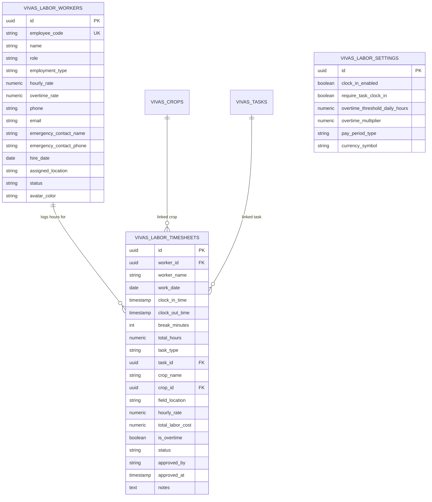

# Implementation Plan - Tend.com Labor Module Integration for Vivas AI

Build the complete **Labor Module** in Vivas AI with full parity to Tend.com's workforce and time management workflow, tailored to Vivas AI's rich design aesthetics, database relationships, and CRUD APIs.

---

## 1. Overview & Architecture

The **Labor Module** consists of three core functional areas:
1. **Time & Attendance (`/labor/time-attendance`)**:
   - **Live Clock In / Out Tracker Widget**: Start shift, select active farm task (*Harvesting, Seeding, Bed Prep, Packhouse Packing, Maintenance*), select linked crop & field location, live timer, break tracking, and end shift.
   - **Timesheets Registry**: Status tabs (*All, Active Clocked-In, Pending Approval, Approved, Rejected*), date filters (*Today, This Week, This Pay Period*), grouping by Worker / Date / Task, total hours vs task hours, hourly pay rates, labor costs (₹), and batch/individual approval actions.
   - **Manual Timesheet Entry Drawer**: Create/edit past timesheets with break duration, task allocation, and manager approval notes.
2. **Crew & Workers Directory (`/labor/crew-manager`)**:
   - Master directory of farm team members, lead operators, harvest crews, and seasonal workers.
   - Track employee IDs (`EMP-001`), roles, employment types (*Full-Time, Part-Time, Seasonal / Daily Wage, Contractor*), standard & overtime hourly pay rates (₹), contact & emergency information, assigned locations, and total logged hours & earnings.
   - Onboard new workers and edit employee profiles with status toggles (*Active, On Leave, Inactive*).
3. **Labor Cost Analytics & Allocation (`/labor/labor-analytics`)**:
   - **KPI Metrics Strip**: Total Farm Labor Hours, Total Labor Cost (₹), Average Hourly Rate (₹), Active Clocked-In Crew, Overtime Hours.
   - **Labor Cost by Task Type**: Interactive distribution across Harvesting, Seeding, Bed Prep, Packing, Irrigation, and Maintenance.
   - **Labor Cost by Crop**: Direct labor cost allocation by crop (Tomatoes, Basil, Microgreens, Carrots, Cucumbers) to determine true crop production cost.
   - **Planned vs Actual Labor Variance**: Compares estimated task labor hours against actual logged timesheet hours.

---

## 2. Proposed Database Schema (`database/labor_migration.sql`)

### Tables & Relationships:

---

## 3. Backend RESTful API Endpoints (`backend/server.js`)

### A. Time & Attendance / Timesheets:
- `GET /api/labor/timesheets` (filters: `status`, `worker_id`, `date`, `date_range`, `task_type`, `search`)
- `GET /api/labor/timesheets/stats` (total hours, total cost, active clocked-in count, pending approval count)
- `GET /api/labor/timesheets/active` (currently active clocked-in shifts)
- `POST /api/labor/clock-in` (start live shift with worker, task, crop, location)
- `POST /api/labor/clock-out` (end shift, calculate total hours and total cost)
- `POST /api/labor/timesheets` (manual timesheet entry)
- `PUT /api/labor/timesheets/:id` (edit timesheet)
- `DELETE /api/labor/timesheets/:id` (delete timesheet)
- `PATCH /api/labor/timesheets/:id/approve` (approve or reject timesheet)
- `POST /api/labor/timesheets/bulk-approve` (bulk approve multiple timesheets)

### B. Crew & Workers:
- `GET /api/labor/workers` (filters: `status`, `role`, `employment_type`, `search`)
- `GET /api/labor/workers/stats` (total crew, active workers, full-time count, seasonal count)
- `GET /api/labor/workers/:id` (single worker profile with timesheet history)
- `POST /api/labor/workers` (create new employee/worker)
- `PUT /api/labor/workers/:id` (update worker)
- `DELETE /api/labor/workers/:id` (delete/deactivate worker)

### C. Labor Analytics & Settings:
- `GET /api/labor/analytics` (labor cost by task type, by crop, planned vs actual variance)
- `GET /api/labor/settings` & `PUT /api/labor/settings` (configure clock-in features & overtime rules)

---

## 4. Frontend Component Structure

### New Files to Create:
1. `frontend/src/labor/TimeAttendance.jsx`:
   - **Live Clock In / Out Widget**: Employee selector, task picker, linked crop dropdown, location, real-time stopwatch timer, Clock In / Start Break / Clock Out buttons.
   - **Top KPI Summary Strip**: Total Logged Hours, Active Clocked-In Workers, Total Labor Cost (₹), Pending Approvals.
   - **Status Filter Tabs**: `All`, `Active Shifts`, `Pending Approval`, `Approved`, `Rejected`.
   - **Timesheets Data Table**: Employee name & avatar, date, shift times, break duration, total hours, task & crop pills, hourly rate, cost (₹), approval status pill, quick Approve/Reject buttons.
   - **Add / Edit Timesheet Modal**: Complete manual time logging drawer.

2. `frontend/src/labor/CrewManager.jsx`:
   - Top KPI Strip: Total Crew Members, Active On Field, Full-Time Staff, Seasonal / Daily Wage, Average Pay Rate (₹/hr).
   - Filter toolbar: Search, Role filter (*Farm Manager, Field Lead, Harvester, Packhouse Specialist, Operator*), Employment Type filter.
   - Worker Cards & Table dual-view: Employee avatar, ID badge (`EMP-001`), role, hourly rate, phone, assigned zone, logged hours, and total earnings.
   - **Add / Edit Worker Drawer**: Profile onboarding form with emergency contacts and pay rate settings.

3. `frontend/src/labor/LaborAnalytics.jsx`:
   - Summary KPIs: Total Labor Expenditure (₹), Total Hours, Average Wage, Task Count.
   - **Labor Cost Distribution by Task**: Visual progress bars & breakdown for Harvesting, Seeding, Bed Prep, Packhouse, Irrigation, Maintenance.
   - **Labor Cost by Crop**: Direct labor cost allocation per crop (Tomatoes, Basil, Microgreens, Carrots, Cucumbers).
   - **Planned vs Actual Hours Variance Table**: Variance analysis comparing task planned time vs actual clocked timesheet hours.

4. `frontend/src/App.jsx` & `frontend/src/index.css`:
   - Wire interactive **Labor** sidebar dropdown with sub-links: *Time & Attendance*, *Crew & Workers*, *Labor Analytics*.
   - Render the three screen views.
   - Add rich CSS tokens for live clock-in widgets, timesheet approval badges, worker profile cards, and analytics progress bars.

---

## 5. Verification Plan

### Automated & Local Verification:
1. Run `database/labor_migration.sql` on PostgreSQL `vivas_ai` database.
2. Restart backend on port 5001 and verify all CRUD endpoints using `curl`.
3. Run `npm run build` in `frontend/` to ensure zero compilation or JSX errors.
4. Launch `browser_subagent` on `http://localhost:5173` to test:
   - Live Clock-in / Clock-out flow, manual timesheet creation, and approval toggle.
   - Crew Manager worker creation, editing, and filtering.
   - Labor Analytics task and crop cost distributions.

### Production Hetzner Deployment:
1. Sync files to `/var/www/vivasai/` via `rsync`.
2. Run database migration on remote PostgreSQL server.
3. Build frontend and restart PM2 `vivasai-backend`.
4. Test live site at `https://vivasdemo.vikramafoods.com` with `browser_subagent` and capture verified screenshots.
