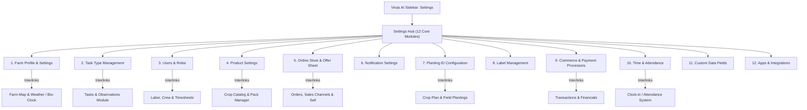

# VivasAI: Tend.com Settings System - Comprehensive Implementation Plan

## Executive Overview
This implementation plan specifies the complete end-to-end architecture, database schema, API layer, field validation engine, and frontend UI components required to replicate **all functionalities of Tend.com Settings** (`https://my.tend.com/settings`) into the local **VivasAI** application.

The design strictly preserves all existing data, matches Vivas AI's aesthetic design system, and deeply interlinks the new settings with existing modules (Tasks, Grow, Crop Plan, Orders, Labor, Map, Contacts, and Financials).

---

## 1. Discovered Tend.com Settings Architecture

Tend.com organizes its Settings page into a clean 12-card grid hub, where each card opens a dedicated management submodule with specialized workflows, tables, and modal dialogs:



---

## 2. Detailed Module Breakdown & Requirements

### Module 1: Farm Profile & Settings (`/settings/farm-settings`)
- **Subtabs**:
  1. **Farm Profile**: Basic Farm Info (Farm Name, Year Founded dropdown, Location Mode [Address autocomplete vs GPS Latitude/Longitude], Farm Size + Unit selector [Acres, Hectares, Sq Ft, Sq Meters], System Operation Type dropdown, Farm Logo file upload & preview, Invoice Header Display Mode radio buttons [Logo + Business Name, Logo Only, Business Name Only], System Farm ID, Delete Farm button with confirmation modal).
  2. **Farm Operations**: Growing format (Beds & Pathways, Greenhouses, Hydroponic, Orchards), Standard Bed & Pathway dimensions (Bed Width, Row Spacing), Operating hours & work days schedule, Default Yield Estimation Base Area, Harvest fulfillment default mode.
  3. **Regional Settings**: Measurement System (Metric [kg, m, ml] vs Standard [lbs, ft, oz]), Temperature unit (°C / °F), Currency symbol & code (₹ INR, $ USD, € EUR, etc.), Timezone selector, Date Format (`DD/MM/YYYY`, `MM/DD/YYYY`, `YYYY-MM-DD`), First & Last Frost Dates (Manual entry, Auto-suggest based on location, or N/A).
  4. **Public Profile**: Farm description/bio, Website URL, Instagram / Facebook social handles, Public contact phone & email, Public address visibility toggle.
  5. **Additional Information**: Organic & Agricultural Certifications (USDA Organic, NPOP India, GlobalGAP, Participatory Guarantee System), Farm Tax / GST / VAT Registration ID, Farm Operator License notes.

### Module 2: Task Type Management (`/settings/task-type-management`)
- **Functionality**:
  - Master catalog of task types organized by Category:
    - *Planting & Sowing*: Broadcast Sow, Furrow Sow, Precision Sow, Container Sow, Transplant, Container Plant.
    - *Crop Maintenance*: Fertilize & Amend, Cultivate, Weed, Prune, Trellis, Scout, Thin, Irrigate, Spray, Flame Weed.
    - *Harvest & Post-Harvest*: Field Harvest, Wash & Pack, Cold Storage Transfer, Quality Inspection.
    - *Infrastructure & Equipment*: Bed Prep, Tillage, Irrigation Setup, Tool Maintenance.
  - **CRUD Operations**:
    - `+ Add Custom Task Type` modal (Task Name, Abbreviation [2-4 letters], Category dropdown, Background Color picker, Text Color picker, Status toggle, Description).
    - `Edit Task Type` modal (Update colors, abbreviation, rename, category).
    - `Delete / Deactivate Task Type` (Soft delete with validation checking if active tasks use this type).
    - Drag-and-drop reordering or rank ordering.
    - Filter by Status (All, Active, Inactive) and Category.

### Module 3: Users & Roles (`/settings/users-roles`)
- **Functionality**:
  - **Tabs**:
    1. *List of Users*: Searchable, paginated table of farm members (User Name, Avatar, Role badge, Email, Phone Number, Status badge [Active, Pending Invite, Deactivated], Last Logged In timestamp, Action menu).
    2. *View Role Permission*: Comprehensive interactive matrix showing 5 predefined roles (Owner, Farm Manager, Field Crew, Harvester, Viewer) across 14 capability areas.
    3. *Audit History*: Log of role changes, invitations sent, and access revokes.
  - **CRUD Operations**:
    - `Add User` modal (First Name, Last Name, Email, Phone Number with country code, Role selection, Hourly Labor Rate, Send Invitation Email toggle).
    - `Add Custom Role` modal (Role Name, Description, Permissions checkboxes).
    - Edit Role / Edit Labor Rate / Revoke Access actions.

### Module 4: Product Settings (`/settings/product-settings`)
- **Functionality**:
  - **Shelf Life Management**: Global shelf life tracking toggle (On/Off), Default shelf life integer input + Unit dropdown (Days, Weeks, Months), Unlimited Shelf Life checkbox exemption.
  - **Inventory Impact Mode**: Radio options:
    - *Standard Inventory Tracking (Default)*: Reduces on-hand stock and updates committed stock when pack orders are fulfilled.
    - *Flexible Tracking*: Allows negative inventory when urgent shipments occur.
    - *No Inventory Impact*: Only track crop log without ledger deductions.
  - Rules table with 4 toggles: Update Committed on pack?, Update On-hand on pack?, Block if stock is short?, Allow negative Available?

### Module 5: Online Store & Offer Sheet Settings (`/settings/online-store`)
- **Functionality**:
  - **Brand & Presentation**: Display name, contact info, brand tagline, order disclaimer.
  - **Checkout & Taxes**: Default Sales Tax / GST Rate (%) with decimal validation.
  - **Delivery Types CRUD**:
    - Table: Method Name, Delivery Fee, Minimum Order Amount, Estimated Delivery Window, Status toggle.
    - `Add / Edit Delivery Method` modal.
  - **Pickup Locations CRUD**:
    - Table: Location Name, Address / Directions, Pickup Schedule / Hours, Active toggle.
    - `Add / Edit Pickup Location` modal.
  - **Order Rules**: Order cutoff hours, minimum notice period, terms of service text editor.

### Module 6: Notification Settings (`/settings/notification-settings`)
- **Functionality**:
  - Sub-category navigation: `Task`, `Equipment`, `Crop Plan`, `Inventory`, `Online Store`.
  - Independent channel toggles: Mobile Push Notification & In-App Notification.
  - Granular event toggles:
    - *Task*: When task is assigned to me, Task due date approaching (24h), Task past due, Task date changed.
    - *Equipment*: Routine maintenance due, Inspection required.
    - *Crop Plan*: Scheduled planting date reached, Harvest window opening.
    - *Inventory*: Low stock threshold reached, Batch expiration warning.
    - *Online Store*: New incoming order, Order canceled, Payment failed.

### Module 7: Planting ID Configuration (`/settings/planting-id-config`)
- **Functionality**:
  - Configurable auto-numbering pattern for plantings:
    1. Pure Auto Number (`001`, `002`, `003`...)
    2. Field-Based Pattern: `[Crop]-[Variety]-[Year]-[Auto Number]` (e.g. `TOM-CHRY-2026-001`)
    3. Location-Based Pattern: `[Location]-[Crop]-[Auto Number]` (e.g. `FLD1-CAR-042`)
  - Sequence Starting Integer (e.g. start at `001` or `1001`).
  - Toggle: "Show all planting IDs as Auto Number only" (Retroactive update with warning modal).
  - Live interactive sample preview of generated ID.

### Module 8: Label Management (`/settings/label-management`)
- **Functionality**:
  - Label template designer and printer setup.
  - Purpose Filters: `All`, `Planting`, `Harvest`, `Location`, `Materials & Inputs Lot`.
  - Table Columns: Design Name, Purpose, Type (Thermal Label, Sheet Avery 5160, Custom), Size (e.g. 4"x2", 2"x1", 3"x5"), Included Dynamic Fields (Badges: Crop, Variety, Harvest Date, Weight, Lot #, Barcode/QR, Organic Badge), Actions (Edit, Duplicate, Delete, Print Sample).
  - `Add Label Template` modal with interactive checkbox builder.

### Module 9: Commerce & Payment Processors (`/settings/commerce-payment`)
- **Functionality**:
  - **Tabs**:
    1. *Payment Processors Setup*: Table of payment gateways (Stripe, Square, Razorpay/UPI, Cash/Check). Status (Connected / Not Configured), Enable toggle, Setup/Configure modal (API Keys, Webhook secret, Currency).
    2. *Commerce Platforms*: Connectors for Shopify, WooCommerce, Square POS.
    3. *Channels and Processors*: Route specific sales channels (Wholesale, CSA, Farm Stand, Online Store) to specific payment processors.

### Module 10: Time & Attendance (`/settings/time-attendance`)
- **Functionality**:
  - `Clock In Feature`: Global toggle to enable/disable worker time clock.
  - `Task Clock-in`: Toggle to require task selection when clocking in.
  - `Geofencing Validation`: Optional distance radius check from farm GPS coordinates.
  - `Overtime Calculation Rules`: Weekly regular hours threshold (40 hrs) and overtime multiplier (1.5x).

### Module 11: Custom Data Fields (`/settings/custom-data-fields`)
- **Functionality**:
  - Dynamic user-defined field system across Vivas AI entities:
    - Target Entities: `Crops`, `Plantings`, `Locations`, `Tasks`, `Equipment`, `Contacts`, `Orders`.
    - Data Types: Text, Numeric, Date, Dropdown/Select (with custom options), Checkbox/Boolean, File attachment.
  - Table: Field Label, Target Entity, Data Type, Options, Required? (Yes/No), Status (Active/Inactive), Actions (Edit, Delete).
  - `Add Custom Field` modal with full validation.

### Module 12: Apps & Integrations (`/settings/apps`)
- **Functionality**:
  - **Personal Access Tokens (API Keys)**:
    - Generate Token modal (Token Name, Permissions scope [Read-Only, Read-Write, Admin], Expiration duration).
    - Table of active tokens (Token Name, Prefix preview, Created Date, Last Used, Revoke button).
  - **Pre-built Webhook & Automation Connectors**:
    - Google Sheets live synchronization.
    - Weather Station IoT API feed.
    - Webhooks Manager: Target URL, Secret Token, Event subscriptions (`order.created`, `task.completed`, `harvest.logged`).

---

## 3. Database Schema Design (`database/settings_migration.sql`)

All tables are created with `IF NOT EXISTS` and foreign keys referencing existing `vivas_farms` and `vivas_users`. No existing tables or data are deleted or altered destructively.

```sql
-- 1. Farm Profile & General Settings
CREATE TABLE IF NOT EXISTS vivas_settings_farm_profile (
    id UUID PRIMARY KEY DEFAULT gen_random_uuid(),
    farm_id UUID REFERENCES vivas_farms(id) ON DELETE CASCADE,
    farm_name VARCHAR(150) NOT NULL,
    year_founded INT DEFAULT 2026,
    location_mode VARCHAR(20) DEFAULT 'address', -- 'address' | 'coords'
    address TEXT,
    city VARCHAR(100),
    state VARCHAR(100),
    country VARCHAR(100) DEFAULT 'India',
    postal_code VARCHAR(30),
    gps_lat NUMERIC(10, 8),
    gps_lng NUMERIC(11, 8),
    farm_size NUMERIC(10, 2),
    farm_size_unit VARCHAR(20) DEFAULT 'Hectares', -- 'Hectares', 'Acres', 'Sq Meters', 'Sq Feet'
    operation_type VARCHAR(100) DEFAULT 'Mixed Vegetable & Fruit Farm',
    logo_url TEXT,
    invoice_header_mode VARCHAR(30) DEFAULT 'LOGO_AND_NAME', -- 'LOGO_AND_NAME', 'LOGO_ONLY', 'NAME_ONLY'
    operating_hours JSONB DEFAULT '{"start": "09:00", "end": "17:00", "work_days": ["Mon","Tue","Wed","Thu","Fri","Sat"]}',
    growing_format VARCHAR(50) DEFAULT 'Beds & Pathways',
    default_bed_width_ft NUMERIC(5, 2) DEFAULT 2.5,
    default_pathway_width_ft NUMERIC(5, 2) DEFAULT 1.5,
    default_yield_area_unit VARCHAR(50) DEFAULT 'Acre', -- Tend requirement: Yield / Acre
    default_yield_mass_unit VARCHAR(20) DEFAULT 'Ton',  -- Tend requirement: Ton
    frost_date_option VARCHAR(30) DEFAULT 'manual', -- 'manual', 'suggested', 'na'
    first_fall_frost DATE,
    last_spring_frost DATE,
    units_system VARCHAR(20) DEFAULT 'Metric', -- 'Metric' | 'Standard'
    temperature_unit VARCHAR(5) DEFAULT 'C',    -- 'C' | 'F'
    currency_code VARCHAR(10) DEFAULT 'INR',
    currency_symbol VARCHAR(5) DEFAULT '₹',
    timezone VARCHAR(50) DEFAULT 'Asia/Kolkata',
    date_format VARCHAR(20) DEFAULT 'DD/MM/YYYY',
    public_description TEXT,
    public_website TEXT,
    instagram_handle VARCHAR(100),
    facebook_handle VARCHAR(100),
    public_phone VARCHAR(50),
    public_email VARCHAR(150),
    show_public_address BOOLEAN DEFAULT TRUE,
    certifications JSONB DEFAULT '["Organic", "Good Agricultural Practices (GAP)"]',
    tax_registration_id VARCHAR(100),
    created_at TIMESTAMPTZ DEFAULT NOW(),
    updated_at TIMESTAMPTZ DEFAULT NOW(),
    CONSTRAINT unique_farm_profile_settings UNIQUE (farm_id)
);

-- 2. Task Type Management Table
CREATE TABLE IF NOT EXISTS vivas_settings_task_types (
    id UUID PRIMARY KEY DEFAULT gen_random_uuid(),
    farm_id UUID REFERENCES vivas_farms(id) ON DELETE CASCADE,
    name VARCHAR(100) NOT NULL,
    abbreviation VARCHAR(10) NOT NULL,
    category VARCHAR(100) NOT NULL, -- 'Planting & Sowing', 'Crop Maintenance', 'Harvesting', etc.
    bg_color VARCHAR(20) DEFAULT '#DEE9E2',
    text_color VARCHAR(20) DEFAULT '#064F32',
    is_active BOOLEAN DEFAULT TRUE,
    sort_order INT DEFAULT 0,
    is_system_default BOOLEAN DEFAULT FALSE,
    description TEXT,
    created_at TIMESTAMPTZ DEFAULT NOW(),
    updated_at TIMESTAMPTZ DEFAULT NOW()
);

-- 3. Roles and Permissions Table
CREATE TABLE IF NOT EXISTS vivas_settings_roles (
    id UUID PRIMARY KEY DEFAULT gen_random_uuid(),
    farm_id UUID REFERENCES vivas_farms(id) ON DELETE CASCADE,
    role_name VARCHAR(100) NOT NULL,
    description TEXT,
    is_custom BOOLEAN DEFAULT FALSE,
    permissions JSONB NOT NULL DEFAULT '{}',
    created_at TIMESTAMPTZ DEFAULT NOW()
);

-- 4. Product Settings Table
CREATE TABLE IF NOT EXISTS vivas_settings_product (
    id UUID PRIMARY KEY DEFAULT gen_random_uuid(),
    farm_id UUID REFERENCES vivas_farms(id) ON DELETE CASCADE,
    shelf_life_tracking_enabled BOOLEAN DEFAULT TRUE,
    default_shelf_life_value INT DEFAULT 10,
    default_shelf_life_unit VARCHAR(20) DEFAULT 'Days', -- 'Days', 'Weeks', 'Months'
    unlimited_shelf_life_enabled BOOLEAN DEFAULT FALSE,
    inventory_impact_mode VARCHAR(30) DEFAULT 'Standard', -- 'Standard', 'Flexible', 'None'
    update_committed_on_pack BOOLEAN DEFAULT TRUE,
    update_on_hand_on_pack BOOLEAN DEFAULT TRUE,
    block_if_stock_short BOOLEAN DEFAULT TRUE,
    allow_negative_available BOOLEAN DEFAULT FALSE,
    created_at TIMESTAMPTZ DEFAULT NOW(),
    updated_at TIMESTAMPTZ DEFAULT NOW(),
    CONSTRAINT unique_farm_product_settings UNIQUE (farm_id)
);

-- 5. Online Store / Offer Sheet Settings Table
CREATE TABLE IF NOT EXISTS vivas_settings_online_store (
    id UUID PRIMARY KEY DEFAULT gen_random_uuid(),
    farm_id UUID REFERENCES vivas_farms(id) ON DELETE CASCADE,
    store_enabled BOOLEAN DEFAULT TRUE,
    brand_farm_name VARCHAR(150),
    brand_year_founded INT,
    brand_address TEXT,
    default_tax_rate NUMERIC(6, 3) DEFAULT 0.000, -- Tax Rate %
    order_cutoff_hours INT DEFAULT 24,
    minimum_order_amount NUMERIC(10, 2) DEFAULT 0.00,
    terms_and_policies TEXT,
    created_at TIMESTAMPTZ DEFAULT NOW(),
    updated_at TIMESTAMPTZ DEFAULT NOW(),
    CONSTRAINT unique_farm_store_settings UNIQUE (farm_id)
);

-- 5b. Delivery Types Table
CREATE TABLE IF NOT EXISTS vivas_settings_delivery_types (
    id UUID PRIMARY KEY DEFAULT gen_random_uuid(),
    farm_id UUID REFERENCES vivas_farms(id) ON DELETE CASCADE,
    method_name VARCHAR(100) NOT NULL,
    delivery_fee NUMERIC(10, 2) DEFAULT 0.00,
    minimum_order_amount NUMERIC(10, 2) DEFAULT 0.00,
    estimated_window VARCHAR(100) DEFAULT 'Next Day Delivery',
    is_active BOOLEAN DEFAULT TRUE,
    created_at TIMESTAMPTZ DEFAULT NOW()
);

-- 5c. Pickup Locations Table
CREATE TABLE IF NOT EXISTS vivas_settings_pickup_locations (
    id UUID PRIMARY KEY DEFAULT gen_random_uuid(),
    farm_id UUID REFERENCES vivas_farms(id) ON DELETE CASCADE,
    location_name VARCHAR(150) NOT NULL,
    address TEXT NOT NULL,
    instructions TEXT,
    schedule VARCHAR(150) DEFAULT 'Saturday 9:00 AM - 1:00 PM',
    is_active BOOLEAN DEFAULT TRUE,
    created_at TIMESTAMPTZ DEFAULT NOW()
);

-- 6. Notification Settings Table
CREATE TABLE IF NOT EXISTS vivas_settings_notifications (
    id UUID PRIMARY KEY DEFAULT gen_random_uuid(),
    farm_id UUID REFERENCES vivas_farms(id) ON DELETE CASCADE,
    user_id UUID REFERENCES vivas_users(id) ON DELETE CASCADE,
    category VARCHAR(50) NOT NULL, -- 'task', 'equipment', 'crop_plan', 'inventory', 'online_store'
    event_key VARCHAR(100) NOT NULL,
    event_title VARCHAR(150) NOT NULL,
    mobile_push_enabled BOOLEAN DEFAULT TRUE,
    in_app_enabled BOOLEAN DEFAULT TRUE,
    created_at TIMESTAMPTZ DEFAULT NOW(),
    updated_at TIMESTAMPTZ DEFAULT NOW(),
    CONSTRAINT unique_user_notification_pref UNIQUE (farm_id, user_id, category, event_key)
);

-- 7. Planting ID Configuration Table
CREATE TABLE IF NOT EXISTS vivas_settings_planting_id (
    id UUID PRIMARY KEY DEFAULT gen_random_uuid(),
    farm_id UUID REFERENCES vivas_farms(id) ON DELETE CASCADE,
    pattern_type VARCHAR(50) DEFAULT 'auto_number', -- 'auto_number', 'crop_variety_year_num', 'location_crop_num'
    starting_sequence INT DEFAULT 1,
    show_auto_number_only BOOLEAN DEFAULT FALSE,
    prefix VARCHAR(20) DEFAULT '',
    separator VARCHAR(5) DEFAULT '-',
    created_at TIMESTAMPTZ DEFAULT NOW(),
    updated_at TIMESTAMPTZ DEFAULT NOW(),
    CONSTRAINT unique_farm_planting_id_settings UNIQUE (farm_id)
);

-- 8. Label Management Table
CREATE TABLE IF NOT EXISTS vivas_settings_labels (
    id UUID PRIMARY KEY DEFAULT gen_random_uuid(),
    farm_id UUID REFERENCES vivas_farms(id) ON DELETE CASCADE,
    design_name VARCHAR(150) NOT NULL,
    purpose VARCHAR(50) NOT NULL, -- 'Planting', 'Harvest', 'Location', 'Materials & Inputs Lot'
    label_type VARCHAR(50) DEFAULT 'Thermal Label', -- 'Thermal Label', 'Sheet (Avery 5160)', 'Sheet (Avery 5163)'
    dimensions VARCHAR(50) DEFAULT '4" x 2"',
    fields_included JSONB NOT NULL DEFAULT '["Crop", "Variety", "Harvest Date", "QR Code"]',
    is_default BOOLEAN DEFAULT FALSE,
    created_at TIMESTAMPTZ DEFAULT NOW(),
    updated_at TIMESTAMPTZ DEFAULT NOW()
);

-- 9. Payment Processors Table
CREATE TABLE IF NOT EXISTS vivas_settings_payment_processors (
    id UUID PRIMARY KEY DEFAULT gen_random_uuid(),
    farm_id UUID REFERENCES vivas_farms(id) ON DELETE CASCADE,
    provider_code VARCHAR(50) NOT NULL, -- 'stripe', 'square', 'razorpay', 'cash_check'
    provider_name VARCHAR(100) NOT NULL,
    is_enabled BOOLEAN DEFAULT FALSE,
    is_test_mode BOOLEAN DEFAULT TRUE,
    publishable_key TEXT,
    secret_key_encrypted TEXT,
    webhook_secret TEXT,
    currency VARCHAR(10) DEFAULT 'INR',
    description TEXT,
    created_at TIMESTAMPTZ DEFAULT NOW(),
    updated_at TIMESTAMPTZ DEFAULT NOW(),
    CONSTRAINT unique_farm_payment_provider UNIQUE (farm_id, provider_code)
);

-- 9b. Channel Payment Mappings Table
CREATE TABLE IF NOT EXISTS vivas_settings_channel_mappings (
    id UUID PRIMARY KEY DEFAULT gen_random_uuid(),
    farm_id UUID REFERENCES vivas_farms(id) ON DELETE CASCADE,
    sales_channel VARCHAR(100) NOT NULL, -- 'Online Store', 'Wholesale', 'CSA', 'Farm Stand'
    default_processor_code VARCHAR(50) NOT NULL,
    created_at TIMESTAMPTZ DEFAULT NOW(),
    CONSTRAINT unique_farm_channel_mapping UNIQUE (farm_id, sales_channel)
);

-- 10. Time & Attendance Settings Table
CREATE TABLE IF NOT EXISTS vivas_settings_time_attendance (
    id UUID PRIMARY KEY DEFAULT gen_random_uuid(),
    farm_id UUID REFERENCES vivas_farms(id) ON DELETE CASCADE,
    clock_in_enabled BOOLEAN DEFAULT TRUE,
    task_clock_in_required BOOLEAN DEFAULT TRUE,
    geofencing_enabled BOOLEAN DEFAULT FALSE,
    geofence_radius_meters INT DEFAULT 500,
    overtime_threshold_hours INT DEFAULT 40,
    overtime_multiplier NUMERIC(3, 2) DEFAULT 1.50,
    created_at TIMESTAMPTZ DEFAULT NOW(),
    updated_at TIMESTAMPTZ DEFAULT NOW(),
    CONSTRAINT unique_farm_time_attendance UNIQUE (farm_id)
);

-- 11. Custom Data Fields Table
CREATE TABLE IF NOT EXISTS vivas_settings_custom_fields (
    id UUID PRIMARY KEY DEFAULT gen_random_uuid(),
    farm_id UUID REFERENCES vivas_farms(id) ON DELETE CASCADE,
    field_label VARCHAR(100) NOT NULL,
    field_key VARCHAR(100) NOT NULL,
    target_entity VARCHAR(50) NOT NULL, -- 'Crops', 'Plantings', 'Locations', 'Tasks', 'Equipment', 'Contacts', 'Orders'
    field_type VARCHAR(30) NOT NULL, -- 'text', 'number', 'date', 'select', 'boolean', 'file'
    select_options JSONB DEFAULT '[]',
    is_required BOOLEAN DEFAULT FALSE,
    default_value TEXT,
    sort_order INT DEFAULT 0,
    is_active BOOLEAN DEFAULT TRUE,
    created_at TIMESTAMPTZ DEFAULT NOW(),
    updated_at TIMESTAMPTZ DEFAULT NOW(),
    CONSTRAINT unique_farm_custom_field UNIQUE (farm_id, target_entity, field_key)
);

-- 12. Personal Access Tokens & Webhooks Table
CREATE TABLE IF NOT EXISTS vivas_settings_api_tokens (
    id UUID PRIMARY KEY DEFAULT gen_random_uuid(),
    farm_id UUID REFERENCES vivas_farms(id) ON DELETE CASCADE,
    user_id UUID REFERENCES vivas_users(id) ON DELETE CASCADE,
    token_name VARCHAR(100) NOT NULL,
    token_hash VARCHAR(255) NOT NULL,
    token_preview VARCHAR(20) NOT NULL, -- e.g. "vivas_live_...9f2b"
    permission_scope VARCHAR(50) DEFAULT 'read_write',
    expires_at TIMESTAMPTZ,
    last_used_at TIMESTAMPTZ,
    is_revoked BOOLEAN DEFAULT FALSE,
    created_at TIMESTAMPTZ DEFAULT NOW()
);

CREATE TABLE IF NOT EXISTS vivas_settings_webhooks (
    id UUID PRIMARY KEY DEFAULT gen_random_uuid(),
    farm_id UUID REFERENCES vivas_farms(id) ON DELETE CASCADE,
    endpoint_url TEXT NOT NULL,
    secret_key VARCHAR(255) NOT NULL,
    subscribed_events JSONB NOT NULL DEFAULT '["order.created", "task.completed"]',
    is_active BOOLEAN DEFAULT TRUE,
    created_at TIMESTAMPTZ DEFAULT NOW()
);
```

---

## 4. Field Validations & Rules Engine

Each field in the settings engine is guarded by strict front-end and back-end validation:

| Module | Field | Validation Rules | Error / Behavior |
| :--- | :--- | :--- | :--- |
| **Farm Profile** | `farm_name` | String, Required, 2-150 chars, no leading/trailing whitespace | "Farm name is required (2-150 chars)" |
| | `year_founded` | Integer, 1800 <= year <= Current Year (2026) | "Year founded must be between 1800 and 2026" |
| | `farm_size` | Decimal, Positive number >= 0.01 | "Farm size must be a positive number" |
| | `gps_lat` / `gps_lng` | Latitude: -90 to +90; Longitude: -180 to +180 | "Invalid GPS coordinates" |
| | `logo_url` | File format: PNG, JPG, WEBP, SVG; Max size 5MB | "Logo must be an image under 5MB" |
| **Task Types** | `name` | String, Required, Unique within farm, 2-100 chars | "Task Type name must be unique" |
| | `abbreviation` | String, Required, 1-6 alphanumeric uppercase | "Abbreviation must be 1-6 uppercase letters" |
| | `bg_color` / `text_color` | Hex Color Code matching regex `^#([A-Fa-f0-9]{6})$` | "Invalid hex color format" |
| **Users & Roles** | `email` | Standard RFC 5322 Email regex, Unique within farm | "Valid email address is required" |
| | `phone_number` | International format `^\+?[1-9]\d{7,14}$` | "Valid phone number with country code required" |
| | `hourly_rate` | Numeric >= 0.00 | "Labor rate cannot be negative" |
| **Product Settings** | `default_shelf_life` | Integer >= 1 | "Shelf life must be at least 1 day" |
| **Online Store** | `default_tax_rate` | Decimal >= 0.000 and <= 100.000 | "Tax rate must be between 0% and 100%" |
| | `delivery_fee` | Decimal >= 0.00 | "Delivery fee cannot be negative" |
| **Planting ID** | `starting_sequence`| Integer >= 1, Max 999999 | "Sequence starting number must be 1 or greater" |
| **Payment Gateways** | `publishable_key` | Regex matching provider key prefix (e.g. `pk_live_` or `pk_test_`) | "Key format does not match provider specifications" |
| **Custom Fields** | `field_key` | Alphanumeric lower case with underscores `^[a-z0-9_]{2,50}$` | "Field key must be snake_case alphanumeric" |

---

## 5. CRUD Operations Specification

All 12 submodules support standard CRUD with optimistic UI updates and backend persistence:

1. **CREATE**:
   - Modal drawers or inline creation forms for Task Types, Users, Roles, Delivery Types, Pickup Locations, Label Templates, Custom Fields, and API Tokens.
   - Immediate front-end validation feedback before payload dispatch.
   - Automatic audit trail timestamp (`created_at`) and attribution to current user.

2. **READ / FILTER / SEARCH**:
   - High-performance filtered queries scoped by `farm_id`.
   - Client-side and server-side text search across names, codes, emails, and categories.
   - Category and status filters (e.g., Task Type Category tabs, Label Purpose dropdown).

3. **UPDATE**:
   - Inline toggle switches for boolean flags (On/Off without needing to reload).
   - Edit dialogs for compound models (Task Type editing, User role adjustments, Delivery methods).
   - "Save Changes" floating sticky banner when form changes are detected, with "Discard" rollback capability.

4. **DELETE / DEACTIVATE**:
   - Soft-delete by default (`is_active = FALSE`) to prevent breaking historical records.
   - Dependency Safeguard: Prevent deleting a Task Type if active incomplete tasks are assigned to it; prompt the user to reassign active tasks first.
   - Farm Deletion Safeguard: Requires typing the exact farm name to confirm, with cascading cleanup.

---

## 6. Cross-Module Interlinking Matrix

| Settings Module | Interlinked Vivas AI Feature | Operational Impact & Data Flow |
| :--- | :--- | :--- |
| **Task Types** | **Tasks & Observations** (`vivas_farm_tasks`) | Newly created task types immediately appear in the "+ Add Task" modal, category filter tabs, and colored calendar cards. |
| **Users & Roles** | **Labor & Crew Management** (`vivas_crew_members`) | Setting user hourly labor rates automatically calculates wage costs in the Labor Analytics dashboard and time attendance sheets. |
| **Product Settings** | **Pack Manager & Orders** (`vivas_orders`) | Shelf life days calculate the expiration date of harvested crates and warn packers when inventory is near expiry. |
| **Online Store** | **Sell & Orders** (`vivas_orders`) | Default tax rate and delivery fees automatically calculate invoice subtotal, tax, and grand total. |
| **Planting ID Config** | **Crop Plan & Grow** (`vivas_plantings`) | New field plantings and greenhouse sowings automatically receive sequential formatted IDs (e.g. `TOM-CHRY-2026-001`). |
| **Label Management** | **Harvest & Inventory Tracking** | Harvest logs display a "Print Label" button that generates thermal/sheet print jobs based on saved templates. |
| **Payment Processors** | **Financials & Transactions** (`vivas_transactions`) | Selected processors sync payments directly into the Financial Summary and revenue accounts. |
| **Time & Attendance** | **Time Tracking Punch Clock** | When enabled, shows the floating / header "Clock In / Clock Out" widget and enforces task selection. |
| **Farm Profile** | **Farm Map & Weather** (`FarmMap.jsx`) | Coordinates and farm size units automatically center the satellite map and configure weather frost alerts. |

---

## 7. Frontend UI / UX Architecture (Vivas AI Design System)

The implementation matches the visual layout of Vivas AI:
- **Container**: `grow-page-container` with `#f8fafc` background, slate typography (`#0f172a`), muted subtext (`#64748b`), and crisp borders (`#e2e8f0`).
- **Hub View**: 12-Card Grid matching Tend's icon badges, titles, and descriptions, with hover elevations (`box-shadow: 0 4px 12px rgba(0,0,0,0.06)`).
- **Navigation**:
  - Clicking sidebar "Settings" switches `currentScreen = 'settings'`, defaulting to the 12-card Hub.
  - Clicking any card opens that module's sub-page with a standard top breadcrumb: `← Settings / [Module Name]`.
  - Profile dropdown "Settings" opens Farm Profile directly.
- **Component File Structure**:
  ```text
  frontend/src/settings/
  ├── SettingsHub.jsx                  # Main 12-card grid overview
  ├── SettingsHeader.jsx               # Breadcrumb, title, search & action buttons
  ├── SettingsStyles.css               # Design system tokens and card styling
  ├── modules/
  │   ├── FarmProfileSettings.jsx      # Module 1 (5 subtabs)
  │   ├── TaskTypeSettings.jsx         # Module 2 (Category table & colors)
  │   ├── UsersRolesSettings.jsx       # Module 3 (Users table, permission matrix)
  │   ├── ProductSettings.jsx          # Module 4 (Shelf life & inventory impact)
  │   ├── OnlineStoreSettings.jsx      # Module 5 (Brand, checkout, delivery, pickup)
  │   ├── NotificationSettings.jsx     # Module 6 (Push & In-app toggles by event)
  │   ├── PlantingIdSettings.jsx       # Module 7 (Auto number pattern builder)
  │   ├── LabelManagementSettings.jsx  # Module 8 (Label templates & designer)
  │   ├── CommercePaymentSettings.jsx  # Module 9 (Processors, channels, keys)
  │   ├── TimeAttendanceSettings.jsx   # Module 10 (Clock-in & overtime rules)
  │   ├── CustomFieldsSettings.jsx     # Module 11 (Dynamic fields builder)
  │   └── AppsIntegrationsSettings.jsx # Module 12 (API tokens & webhooks)
  └── modals/
      ├── AddTaskTypeModal.jsx
      ├── AddUserModal.jsx
      ├── AddRoleModal.jsx
      ├── AddDeliveryModal.jsx
      ├── AddPickupModal.jsx
      ├── AddLabelTemplateModal.jsx
      ├── ConnectPaymentModal.jsx
      ├── AddCustomFieldModal.jsx
      └── GenerateTokenModal.jsx
  ```

---

## 8. Backend API Routes (`backend/routes/settings.js`)

Mounted at `/api/settings`:
- `GET /api/settings/overview?farmId=...` - Get summary counters across all 12 modules
- `GET /api/settings/farm-profile?farmId=...` & `PUT /api/settings/farm-profile`
- `GET /api/settings/task-types?farmId=...` & `POST / PUT / DELETE /api/settings/task-types/:id`
- `GET /api/settings/users?farmId=...` & `POST / PUT / DELETE /api/settings/users/:id`
- `GET /api/settings/roles?farmId=...` & `POST / PUT /api/settings/roles/:id`
- `GET /api/settings/product?farmId=...` & `PUT /api/settings/product`
- `GET /api/settings/online-store?farmId=...` & `PUT /api/settings/online-store`
- `GET /api/settings/delivery-types?farmId=...` & `POST / PUT / DELETE /api/settings/delivery-types/:id`
- `GET /api/settings/pickup-locations?farmId=...` & `POST / PUT / DELETE /api/settings/pickup-locations/:id`
- `GET /api/settings/notifications?farmId=...` & `PUT /api/settings/notifications`
- `GET /api/settings/planting-id?farmId=...` & `PUT /api/settings/planting-id`
- `GET /api/settings/labels?farmId=...` & `POST / PUT / DELETE /api/settings/labels/:id`
- `GET /api/settings/payment-processors?farmId=...` & `PUT /api/settings/payment-processors/:id`
- `GET /api/settings/time-attendance?farmId=...` & `PUT /api/settings/time-attendance`
- `GET /api/settings/custom-fields?farmId=...` & `POST / PUT / DELETE /api/settings/custom-fields/:id`
- `GET /api/settings/api-tokens?farmId=...` & `POST / DELETE /api/settings/api-tokens/:id`

---

## 9. Suggestions & Enhancements for Your Consideration

1. **Dual Currency & Payment Gateway Support**:
   - In addition to Tend's US-centric Stripe/Square, we propose including built-in support for **Razorpay / UPI / NetBanking** to accommodate Indian farms alongside USD/EUR.
2. **Seed Default Task Types**:
   - When the migration runs, automatically seed the 22 standard agricultural task types observed on Tend (Broadcast Sow, Transplant, Furrow Sow, Prune, Scout, Irrigate, Harvest, Pack, etc.) with their official color palettes so the screen is immediately populated and useful.
3. **Seed Default Role Permission Matrix**:
   - Provide standard permissions for Owner, Farm Manager, Field Crew, Harvester, and Viewer.
4. **Retroactive Planting ID Updater**:
   - When switching Planting ID format in Module 7, offer an optional button to reformat existing draft plantings or apply only to new plantings.
5. **Interactive Label Preview & Thermal Print Mode**:
   - In Label Management, include a live canvas preview showing the barcode/QR code and thermal printer simulated output.

---

## 10. Execution Stages (Ready to start upon approval)

1. **Stage 1**: Execute `database/settings_migration.sql` to create all 17 tables and seed default task types, roles, and settings.
2. **Stage 2**: Implement `backend/routes/settings.js` with full validation, CRUD operations, and mount it in `server.js`.
3. **Stage 3**: Build frontend components under `frontend/src/settings/` (12 module views, 9 modals, styling).
4. **Stage 4**: Integrate the sidebar and user menu "Settings" links in `App.jsx`, wiring interlinks with Tasks, Labor, Orders, Plantings, and Map.
5. **Stage 5**: End-to-end verification via automated tests and browser validation.
