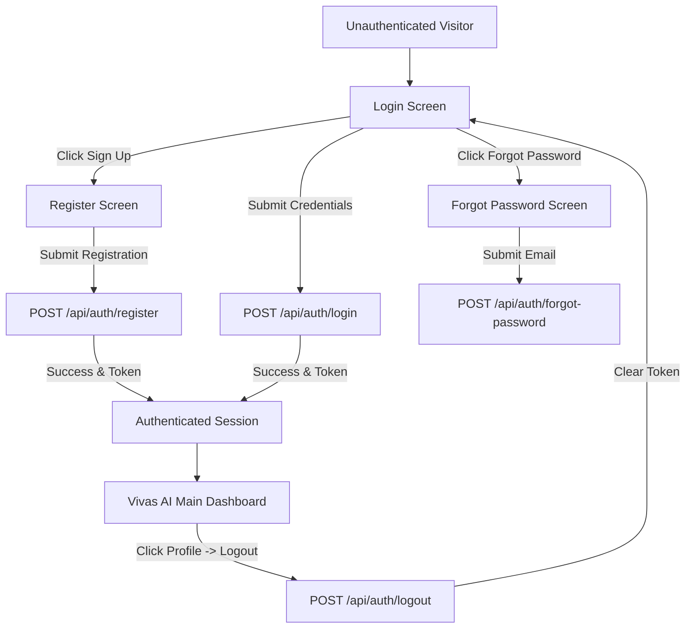

# Implementation Plan - User Authentication System (Registration, Login, Forgot Password, Logout)

Build a complete, secure, and dedicated **User Authentication System** in Vivas AI featuring **User Registration (Sign Up)**, **Login**, **Forgot Password / Password Reset**, and **Logout** with full backend REST APIs, PostgreSQL persistence, and Vivas AI rich green glassmorphism aesthetics.

---

## Proposed Architectural Flow

---

## User Review Required

> [!IMPORTANT]
> - **Separate Auth Pages**: Unauthenticated users will be greeted with dedicated Vivas AI Login, Sign Up, and Forgot Password screens before accessing the main dashboard.
> - **Session Persistence**: User sessions will be saved in local storage so logged-in users remain signed in across page refreshes.
> - **No Third-Party References**: The UI and codebase will strictly adhere to Vivas AI styling and branding without any external reference content.

---

## Proposed Changes

### 1. Database Schema & Migration

#### [NEW] [`auth_migration.sql`](file:///Volumes/Files/Antigravity%20demo/VivasAI/database/auth_migration.sql)
- Create `vivas_users` table:
  - `id`: `UUID PRIMARY KEY DEFAULT gen_random_uuid()`
  - `full_name`: `VARCHAR(255) NOT NULL`
  - `email`: `VARCHAR(255) UNIQUE NOT NULL`
  - `password_hash`: `TEXT NOT NULL`
  - `farm_name`: `VARCHAR(255)`
  - `role`: `VARCHAR(50) DEFAULT 'Farm Manager'`
  - `reset_token`: `VARCHAR(255)`
  - `reset_token_expires`: `TIMESTAMP WITH TIME ZONE`
  - `is_active`: `BOOLEAN DEFAULT TRUE`
  - `created_at`, `updated_at`
- Seed default initial admin user account for easy access testing.

---

### 2. Backend API Server

#### [MODIFY] [`server.js`](file:///Volumes/Files/Antigravity%20demo/VivasAI/backend/server.js)
- Implement Authentication Endpoints:
  - `POST /api/auth/register`: Validate inputs, hash password with `bcryptjs` or SHA-256 fallback, insert user, return auth token & user object.
  - `POST /api/auth/login`: Validate credentials against `vivas_users`, return token & user info.
  - `POST /api/auth/forgot-password`: Generate secure reset token with expiration (1 hour), save to database, return confirmation payload.
  - `POST /api/auth/reset-password`: Validate reset token, update user password, invalidate reset token.
  - `GET /api/auth/me`: Validate user token and return fresh user profile.
  - `POST /api/auth/logout`: Invalidate user session token.

---

### 3. Frontend Authentication UI

#### [NEW] [`AuthContainer.jsx`](file:///Volumes/Files/Antigravity%20demo/VivasAI/frontend/src/auth/AuthContainer.jsx)
- Multi-view Auth component holding **Login**, **Register**, and **Forgot Password** screens.
- **Login Screen**: Email & Password inputs, "Remember me" checkbox, "Forgot password?" link, and "Create an account" button.
- **Register Screen**: Full Name, Farm Name, Email Address, Password, Confirm Password, and Role selection.
- **Forgot Password Screen**: Email Address input, Send Reset Link action, and "Back to Sign In" navigation.
- Rich Vivas AI aesthetics (`#064f32` green gradient, floating farm cards, smooth input focus, inline validation errors).

#### [MODIFY] [`App.jsx`](file:///Volumes/Files/Antigravity%20demo/VivasAI/frontend/src/App.jsx)
- Add `currentUser`, `isAuthenticated`, and `authToken` state.
- Check authentication status on application mount via `GET /api/auth/me`.
- Render `AuthContainer` when `isAuthenticated` is `false`.
- Render top navbar profile dropdown with real user name, email, farm name, and functional **Logout** button that calls `POST /api/auth/logout` and clears local storage.

---

## Verification Plan

### Automated Tests
- Run database migration script via Node.js pool script.
- Execute `curl` tests against `/api/auth/register`, `/api/auth/login`, `/api/auth/forgot-password`, `/api/auth/me`, and `/api/auth/logout`.
- Run `npm run build` in `frontend/` to confirm zero compilation or bundling errors.

### Manual Verification
- Test user registration with new credentials.
- Test login with created user credentials.
- Test forgot password token generation & reset flow.
- Test Logout action from top profile dropdown menu.
