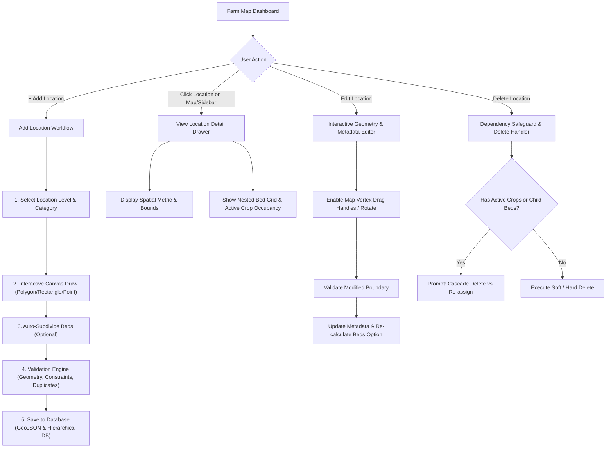
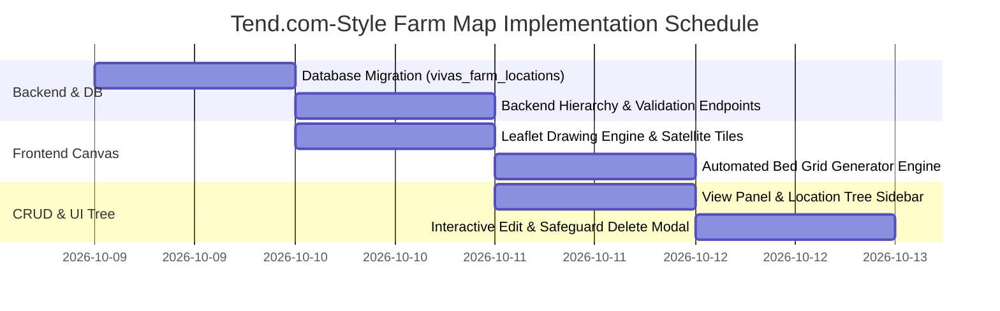

# Final Implementation Plan: Tend.com-Style Interactive Farm Map & Location CRUD System

This document provides the complete, end-to-end architectural, data schema, validation, and CRUD implementation plan for upgrading VivasAI's **Farm Map & Location Management** system to match the workflow of **Tend.com**.

---

## 1. Executive Summary & Tend.com Gap Analysis

| Feature | Current VivasAI | Tend.com Target Standard |
| :--- | :--- | :--- |
| **Location Creation** | Manual numeric coordinate form | Interactive canvas drawing (Polygon, Rectangle, Point Marker) on Satellite tiles |
| **Hierarchy Level** | Flat list (all items at single level) | Multi-tier nesting (`Field/Facility` → `Block/Zone` → `Beds/Rows/Benches`) |
| **Bed Generation** | Manual bed count integer input | Automatic parallel bed grid generator with spacing, width, and angle orientation |
| **View Provision** | Basic sidebar card | Interactive spatial overlay, detailed drawer, area metrics, active planting status |
| **Edit Provision** | Text form edit only | Interactive map vertex drag & resize + metadata update + bed auto-realignment |
| **Delete Provision** | Basic delete confirmation | Dependency-aware delete modal (Cascade beds, unlink beds, active crop safeguards) |

---

## 2. Architecture & Data Flow



---

## 3. Database Schemas & Field Definitions

### 3.1 Main Location Master Table (`vivas_farm_locations`)

```sql
-- PostgreSQL Migration for Tend.com-style Farm Locations
CREATE TABLE IF NOT EXISTS vivas_farm_locations (
  id UUID PRIMARY KEY DEFAULT gen_random_uuid(),
  farm_id UUID REFERENCES vivas_farms(id) ON DELETE CASCADE,
  parent_id UUID REFERENCES vivas_farm_locations(id) ON DELETE CASCADE, -- Hierarchical nesting
  
  -- Core Identification
  name VARCHAR(150) NOT NULL,
  code VARCHAR(50),                                -- e.g. "FLD-NORTH-01"
  location_level VARCHAR(30) NOT NULL DEFAULT 'field', -- 'facility', 'field', 'block', 'bed'
  location_type VARCHAR(50) NOT NULL,              -- 'Outdoor Field', 'Greenhouse', 'High Tunnel', 'Hydroponics', 'Storage', etc.
  
  -- Spatial & Geometry (GeoJSON & Leaflet Compatible)
  shape_type VARCHAR(30) NOT NULL DEFAULT 'polygon', -- 'polygon', 'rectangle', 'marker', 'polyline'
  geojson JSONB NOT NULL,                           -- GeoJSON Geometry object ({ type: "Polygon", coordinates: [...] })
  gps_lat NUMERIC(10, 8),                            -- Center Latitude
  gps_lng NUMERIC(11, 8),                            -- Center Longitude
  color VARCHAR(20) DEFAULT '#2e7d32',              -- Map fill color
  orientation_deg NUMERIC(5, 2) DEFAULT 0,         -- Orientation angle (0° - 360°)
  
  -- Dimensions & Metrics
  width_ft NUMERIC(10, 2),
  length_ft NUMERIC(10, 2),
  total_area_sqft NUMERIC(12, 2),
  usable_area_sqft NUMERIC(12, 2),
  
  -- Bed Grid Configuration (If Parent Field/Block)
  total_beds_count INT DEFAULT 0,
  bed_width_ft NUMERIC(5, 2),
  bed_spacing_ft NUMERIC(5, 2),
  
  -- Operational Details
  field_type VARCHAR(50),                           -- 'Open Field', 'Controlled Environment', etc.
  irrigation_type VARCHAR(50),                      -- 'Drip', 'Sprinkler', 'Sub-surface', etc.
  soil_type VARCHAR(100),                           -- 'Loam', 'Sandy Clay', etc.
  sun_exposure VARCHAR(50),                         -- 'Full Sun', 'Partial Shade', etc.
  notes TEXT,
  
  -- Status & Audit
  is_active BOOLEAN DEFAULT TRUE,
  created_at TIMESTAMPTZ DEFAULT NOW(),
  updated_at TIMESTAMPTZ DEFAULT NOW()
);

-- Indexes for performance
CREATE INDEX IF NOT EXISTS idx_vfl_farm ON vivas_farm_locations(farm_id);
CREATE INDEX IF NOT EXISTS idx_vfl_parent ON vivas_farm_locations(parent_id);
CREATE INDEX IF NOT EXISTS idx_vfl_level ON vivas_farm_locations(location_level);
CREATE INDEX IF NOT EXISTS idx_vfl_geojson ON vivas_farm_locations USING gin(geojson);
```

### 3.2 Micro-Locations / Bed Table (`vivas_farm_location_beds`)

```sql
-- Micro-location table for individual beds nested within fields/blocks
CREATE TABLE IF NOT EXISTS vivas_farm_location_beds (
  id UUID PRIMARY KEY DEFAULT gen_random_uuid(),
  location_id UUID NOT NULL REFERENCES vivas_farm_locations(id) ON DELETE CASCADE,
  bed_number INT NOT NULL,                          -- Index within parent (e.g. Bed 1, Bed 2)
  name VARCHAR(100) NOT NULL,                       -- e.g. "Bed 01"
  
  -- Bed Dimensions
  width_ft NUMERIC(5, 2) NOT NULL,
  length_ft NUMERIC(10, 2) NOT NULL,
  area_sqft NUMERIC(10, 2) NOT NULL,
  
  -- Spatial Box Geometry for individual bed
  geojson JSONB NOT NULL,
  
  -- Status & Crop Linkage
  current_status VARCHAR(30) DEFAULT 'available',   -- 'available', 'planted', 'fallow', 'prepping'
  active_crop_name VARCHAR(100),
  active_planting_id UUID,
  
  created_at TIMESTAMPTZ DEFAULT NOW(),
  updated_at TIMESTAMPTZ DEFAULT NOW(),
  UNIQUE(location_id, bed_number)
);
```

---

## 4. Comprehensive Validation Framework

### 4.1 Frontend Validations (Real-Time in `FarmMap.jsx`)
- **Name & Code Uniqueness**: Ensure location name is non-empty and unique within the same parent/farm.
- **Dimensional Constraints**:
  - `Width` and `Length` must be positive numbers (`> 0`).
  - `Bed Width` must be less than total container width.
  - `Bed Spacing` must be non-negative (`>= 0`).
- **GPS Bounds**: Latitude must be between `-90` and `90`; Longitude between `-180` and `180`.
- **Polygon Vertex Count**: Polygon drawings must have at least 3 distinct non-collinear points.

### 4.2 Spatial & Geometric Validations
- **Self-Intersection Check**: Ensure drawn polygon lines do not cross over themselves (Simple Polygon validation).
- **Bounding Containment Validation**: When adding a child block or bed, verify its geometry is completely contained inside the parent boundary geometry.
- **Minimum Enclosed Area**: Polygon area must be at least 1 sq ft to prevent accidental micro-dots.

### 4.3 Backend API Validations (`backend/routes/farmMap.js`)
- **Circular Hierarchy Prevention**: Prevent setting a location's `parent_id` to itself or any of its sub-children.
- **Active Planting Safeguard on Delete**: Reject deletion if active crops are currently planted without explicit user override confirmation (`force_delete=true`).

---

## 5. Complete Location CRUD Provisions

```carousel

<!-- slide -->

```

### 5.1 VIEW Location Provision
When a location (Field, Block, or Bed) is selected on the Leaflet map or sidebar tree:
1. **Interactive Spatial Highlight**: Highlights the perimeter boundary with dynamic accent stroke and subtle fill glow.
2. **Slide-Out Location Details Panel**:
   - **Metrics Card**: Calculates Total Area (sq ft & Acres/Hectares), Usable Bed Area, and Bed Count.
   - **Nested Structure View**: Lists all internal blocks/beds with live status badges (`Available`, `Planted`, `Fallow`).
   - **Active Plantings List**: Displays current crop variety, planting date, and projected harvest date for selected location.
   - **Satellite Map Preview**: Quick zoom-to-fit button.

### 5.2 EDIT Location Provision
Allows updating both **Metadata** and **Map Geometry**:
1. **Interactive Geometry Edit Mode**:
   - Map switches into Leaflet Edit mode (`leaflet-draw` edit handles).
   - Drag vertices to reshape field boundary.
   - Drag edge midpoints to add new boundary vertices.
   - Rotate handle to adjust bed grid orientation angle.
2. **Auto-Realignment of Child Beds**:
   - When parent field boundary is edited, user is prompted: `"Recalculate and realign nested beds to fit new boundary?"`.
3. **Metadata Editing**:
   - Update Name, Field Type, Irrigation Type, Soil Type, and Notes.

### 5.3 DELETE Location Provision
Includes comprehensive safety dependency checks:
1. **Deletion Trigger**: Click "Delete Location" from detail drawer or sidebar item menu.
2. **Dependency Inspection Modal**:
   - Checks for **Child Locations** (e.g., 20 nested beds).
   - Checks for **Active Plantings** (e.g., 5 beds currently growing Tomato & Lettuce).
3. **User Choice Options**:
   - **Cascade Delete**: Delete parent location AND all child beds (only allowed if no active plantings exist or explicitly confirmed).
   - **Unlink Child Beds**: Remove parent association while preserving beds.
   - **Cancel**: Abort deletion safety.

---

## 6. Implementation Phasing & Task List



### Milestones
1. **Day 1**: Run database migrations for `vivas_farm_locations` and `vivas_farm_location_beds`. Build backend CRUD and tree endpoints with validation checks.
2. **Day 2**: Upgrade `frontend/src/FarmMap.jsx` with Esri/Google Satellite imagery and `leaflet-draw` polygon/rectangle drawing controls.
3. **Day 3**: Implement parallel bed grid calculation engine and sidebar location hierarchy tree.
4. **Day 4**: Implement View drawer, Interactive Vertex Edit mode, dependency-aware Delete modal, and perform end-to-end verification.

---

## 7. Verification & Acceptance Criteria

1. **Polygon Canvas Drawing**: Users can trace custom field boundaries on satellite view; vertex GeoJSON saves accurately to PostgreSQL.
2. **Automated Bed Subdivision**: Creating a 100ft × 60ft field auto-generates parallel bed polygons matching specified bed width & spacing.
3. **Validation Engine**: Self-intersecting polygons or negative dimensions trigger clear error messages before saving.
4. **CRUD Completeness**:
   - **View**: Selecting any location highlights geometry and opens detailed metrics drawer.
   - **Edit**: Dragging polygon vertices updates map geometry and saves updated GeoJSON.
   - **Delete**: Attempting to delete a field with active crops prompts safeguard modal.

---

> [!IMPORTANT]
> This final plan provides a complete blueprint for database schema, validation rules, interactive drawing, and full location CRUD functionality.
